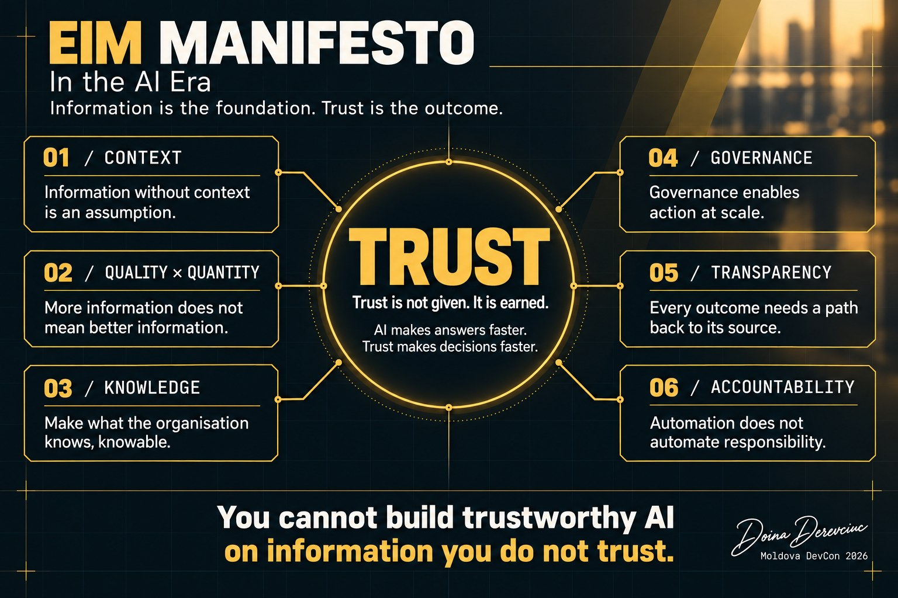

# EIM Manifesto in the AI Era

*AI is only as good as the information behind it.*

  

## TRUST

**Trust is not given. It is earned.**  
**AI makes answers faster. Trust makes decisions faster.**

---

## Six principles that create the conditions for trust

### 01 · Context
Information without context is an assumption.
AI can process information. It cannot recover context we failed to preserve.

→ [Read more](principles/01-context.md)

### 02 · Quality × Quantity
More information does not mean better information.
AI makes information quality more consequential, not less.

→ [Read more](principles/02-quality-x-quantity.md)

### 03 · Knowledge
Make what the organisation knows, knowable.
AI cannot leverage knowledge the enterprise never made explicit.

→ [Read more](principles/03-knowledge.md)

### 04 · Governance
Governance enables action at scale.
Speed without guardrails does not eliminate risk. It accelerates it.

→ [Read more](principles/04-governance.md)

### 05 · Transparency
Every outcome needs a path back to its source.
AI can simplify the answer. It must never make its origin invisible.

→ [Read more](principles/05-transparency.md)

### 06 · Accountability
Automation does not automate responsibility.
Responsibility does not disappear when human intervention does.

→ [Read more](principles/06-accountability.md)

---

## The mandate

**Ask not only what we can automate, but what we understand.**  
**You cannot build trustworthy AI on information you do not trust.**

---

## Before AI acts, remember ACTS

| | Step | Carries principles |
|---|---|---|
| **A** | **Ask** who decides what the data means | 04 Governance |
| **C** | **Comprehend** the context and the knowledge behind it | 01 Context · 03 Knowledge |
| **T** | **Trace** the answer to a source you trust | 02 Quality × Quantity · 05 Transparency |
| **S** | **Ship** with safeguards and a named owner | 06 Accountability |

Six principles. Four letters. One habit. → [The ACTS checklist](practice/ACTS.md)

---

*Author: Doina Derevciuc · Moldova DevCon 2026 · Open to pull requests*
