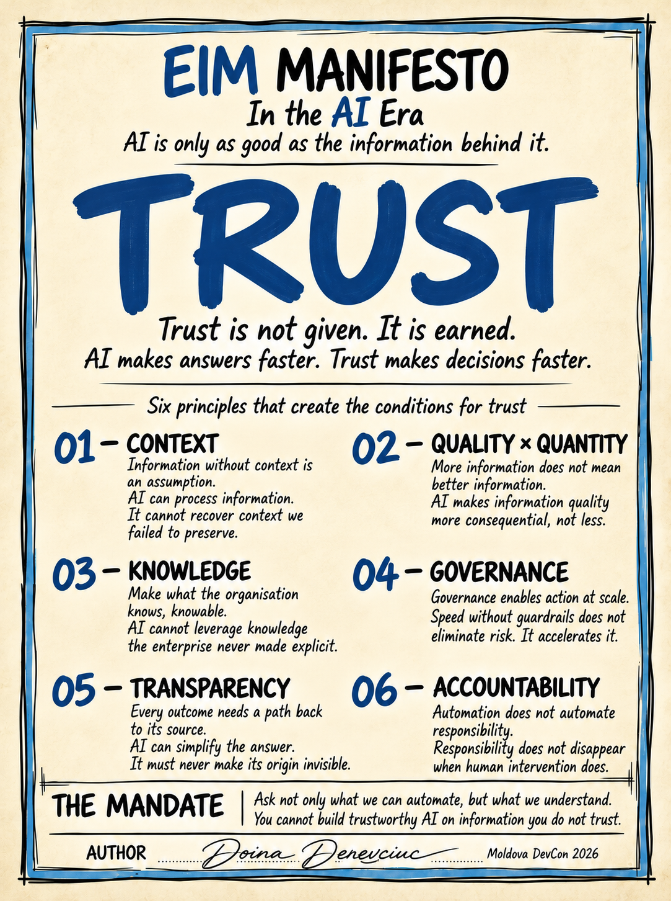

# EIM Manifesto in the AI Era

**AI is only as good as the information behind it.**

Six principles that create the conditions for trust in enterprise information, so AI can act on it.

> You cannot build trustworthy AI on information you do not trust.

<p align="center">
  <a href="MANIFESTO.md"></a>
</p>

This repository is the take-home from the talk *EIM Manifesto in the AI Era*,
given at Moldova DevCon 2026 (6–7 November 2026, Chișinău).
It is open to pull requests: if you've lived one of these stories, or a principle
is missing a case, help make it better.

📜 **[Read the manifesto →](MANIFESTO.md)**

---

## The mandate

**Ask not only what we can automate, but what we understand.**

## The six principles

| # | Principle | In one line |
|---|---|---|
| 01 | [Context](principles/01-context.md) | Information without context is an assumption. |
| 02 | [Quality × Quantity](principles/02-quality-x-quantity.md) | More information does not mean better information. |
| 03 | [Knowledge](principles/03-knowledge.md) | Make what the organisation knows, knowable. |
| 04 | [Governance](principles/04-governance.md) | Governance enables action at scale. |
| 05 | [Transparency](principles/05-transparency.md) | Every outcome needs a path back to its source. |
| 06 | [Accountability](principles/06-accountability.md) | Automation does not automate responsibility. |

01–03 are about the information. 04–06 are about how we act on it.

## Your Monday recipe: ACTS

Before AI acts, remember **ACTS**: **A**sk · **C**omprehend · **T**race · **S**hip.
See [practice/ACTS.md](practice/ACTS.md) for the checklist, and
[practice/exceptions-inventory.md](practice/exceptions-inventory.md) for a
first exercise to run with your team.

## The stories behind it

- [The perfect migration](stories/the-perfect-migration.md): we migrated every tree and lost the forest.
- [Zero annulments](stories/zero-annulments.md): the rule that lived in someone's memory, and why AI cannot whisper.

## Repository layout

```
MANIFESTO.md          the manifesto, one page
assets/               the manifesto poster (print it, share it)
principles/           one file per principle: what, why, story, practice, questions
practice/             ACTS checklist and team exercises
stories/              the case stories from the talk
CONTRIBUTING.md       how to propose changes
```

## Contributing

Pull requests are welcome, especially:
- a real-world story that illustrates a principle (anonymised),
- a practical check or question for one of the principles,
- a translation of the manifesto (Romanian and Russian first, please!).

Read [CONTRIBUTING.md](CONTRIBUTING.md) first. Changes to the wording of the six
principles are discussed in an issue before a PR.

## Sign the manifesto

Agree with it? Add your name to [SIGNATORIES.md](SIGNATORIES.md) with a pull request.

## License

Text is licensed under [Creative Commons Attribution 4.0](LICENSE) (CC BY 4.0).
Share it, adapt it, use it in your own talks and teams. Just credit the source.

---

*Author: Doina Denevciuc · Moldova DevCon 2026*
